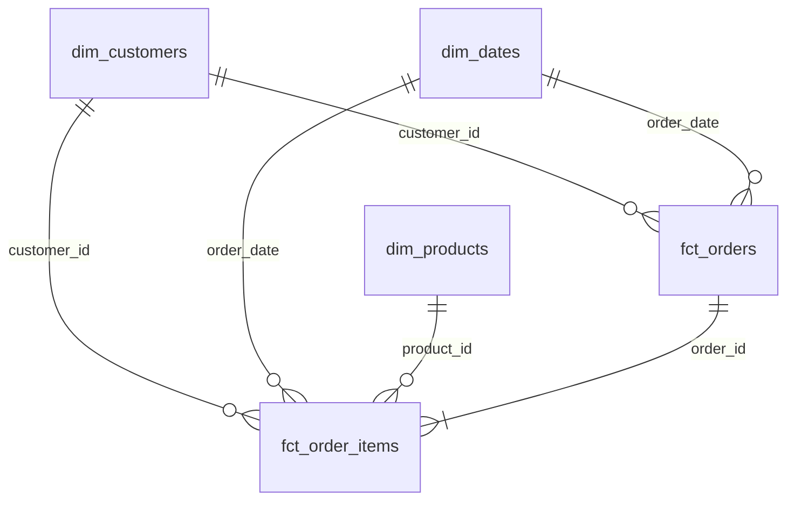
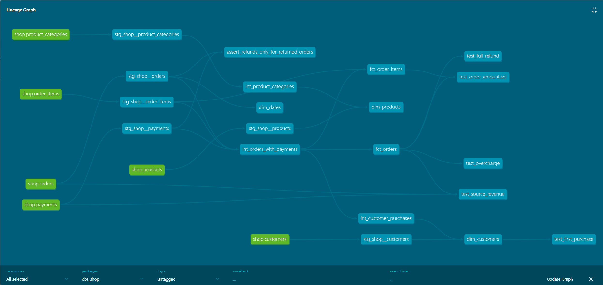

# Домашнее задание 1

Саакова Екатерина, БЭАД

## Модель данных

Данные магазина лежат в PostgreSQL. Сервис loader копирует их в Greenplum, в схему raw. Дальше dbt обрабатывает их в три шага: staging (очистка), intermediate (соединения и расчеты) и marts (готовые витрины). Витрины построены по схеме "звезда": два факта и три измерения.

Что лежит в витринах:

- fct_orders: одна строка - один заказ, тестовые заказы убраны. Выручка по месяцам, средний чек по городам
- fct_order_items: одна строка - один товар в заказе. Выручка по категориям, брендам, бренды с частыми возвратами
- dim_customers: одна строка - один кликент, включая тех, кто ничего не купил. Доля покупателей по каналам привлечения
- dim_products: одна строка - один товар. Бренд, категория, родительская и верхняя категория
- dim_dates: одна строка - один день. Отчеты по месяцам, кварталам, дням недели

### Хранение в Greenplum

| Витрина | Распределение | Почему так |
|---|---|---|
| fct_orders | distributed by (order_id) | Ключ уникальный, строки распределяются по сегментам равномерно. Сырые orders, order_items и payments распределены по тому же ключу, соединение по заказу выполняется локально на сегменте |
| fct_order_items | distributed by (order_id), колоночное хранение | Ключ совпадает с fct_orders, соединение выполняется без пересылки строк между сегментами. При разных ключах Greenplum перераспределял бы данные. Испльзуется колоночное хранение, тк это самая большая таблица, запросы читают из нее только несколько колонок |
| dim_customers | distributed replicated | Небольшой справочник, копия на каждом сегменте, соединение с фактами без пересылки |
| dim_products | distributed replicated | Небольшой справочник товаров |
| dim_dates | distributed replicated | Небольшой календарь (133 дня) |

### Граф зависимостей

## Тесты

Кроме стандартных тестов (unique, not_null, relationships, accepted_values) реализован generic-тест non_negative, который проверяет, что значение не меньше нуля. Также существуют другие пять singular-тестов:

- test_order_amount проверяет, что сумма заказа равна сумме его позиций
- test_source_revenue сверяет сумму подтвержденных покупок в витрине с подсчетом прямо по сырым orders и payments
- test_full_refund проверяет, что по возвращенным заказам деньги вернули полностью
- test_overcharge проверяет, что с подтвержденного заказа не списали больше его суммы
- test_first_purchase проверяет, что первая покупка была не раньше регистрации

Тест test_overcharge выдает WARN на заказе 113: сумма заказа 200, успешных списаний два по 200 (двойное списание). Ошибка в данных платежей, а не в моделях, поэтому данные не исправлялись, тесту задан severity: warn. На выручку это не влияет, тк она считается по сумме заказа, а не по платежам.

## Дополнительное задание

fct_order_items - инкрементальная модель. Сачала таблица строится целиком, а при следующих запусках в нее добавляются только позиции новых заказов. Из-за этого модель не увидит часть изменений в источнике:

- если у старого заказа поменялся статус или по нему пришла оплта, в витрине останутся старые данные
- если в старом заказе исправили количество, цену или скидку
- если заказ или позицию удалили
- если заказ пришел с опозданием и его время создания раньше последнего загруженного